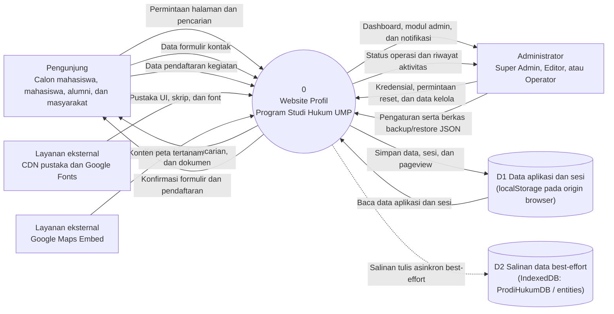
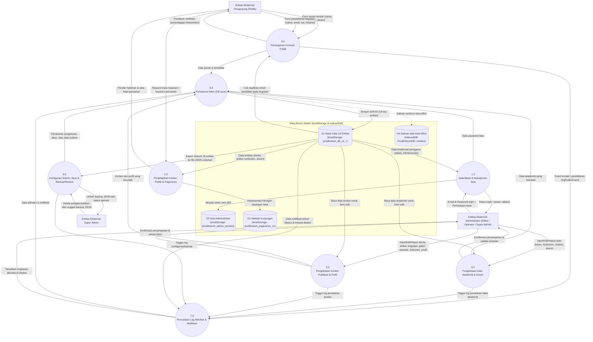
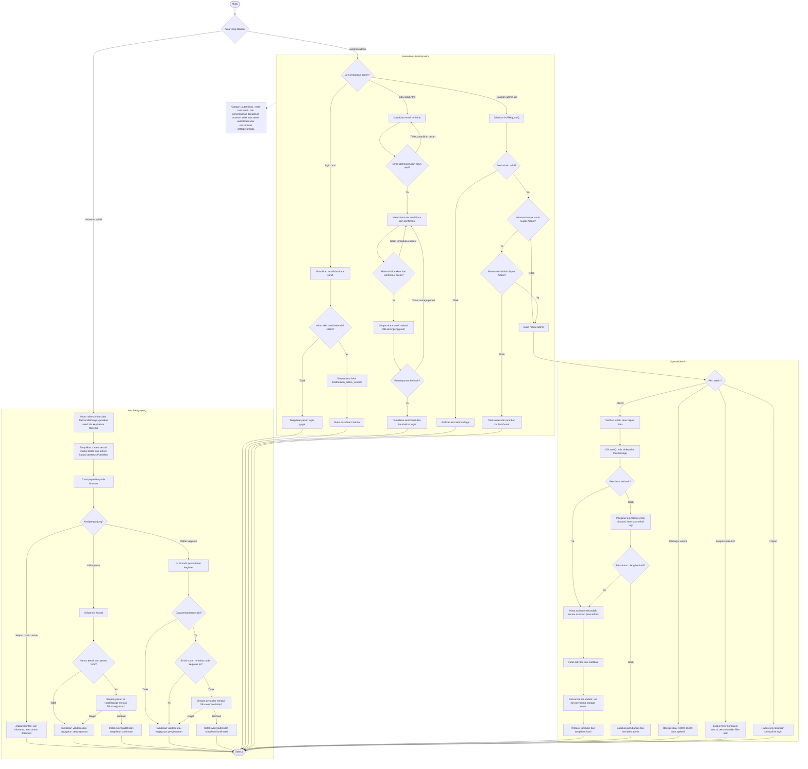
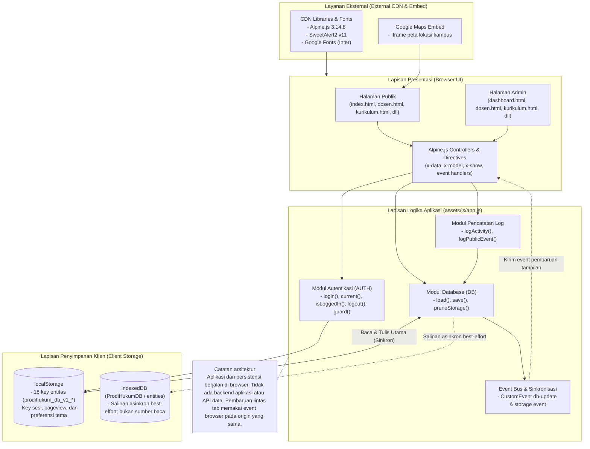
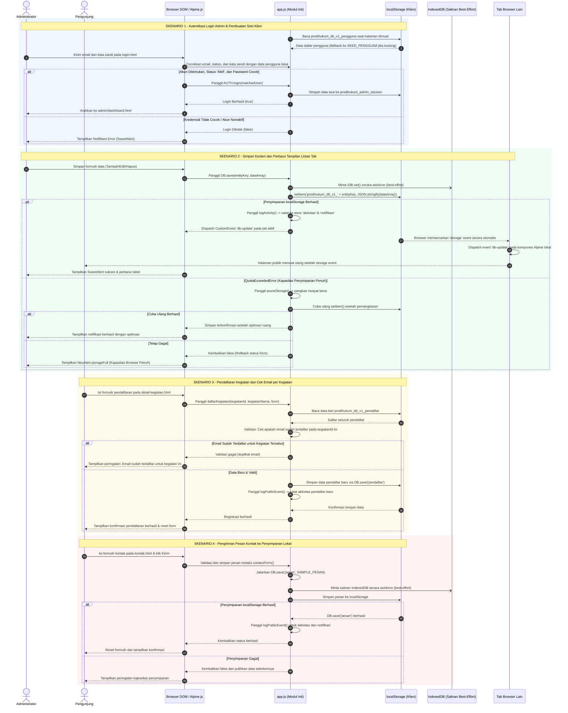
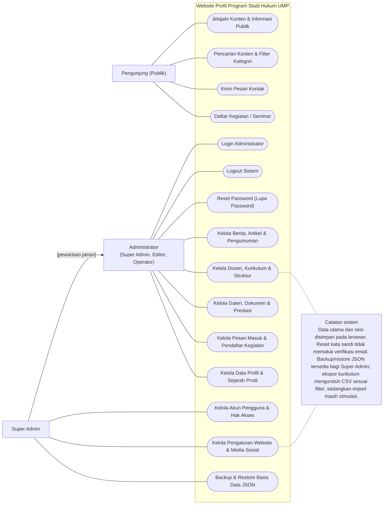
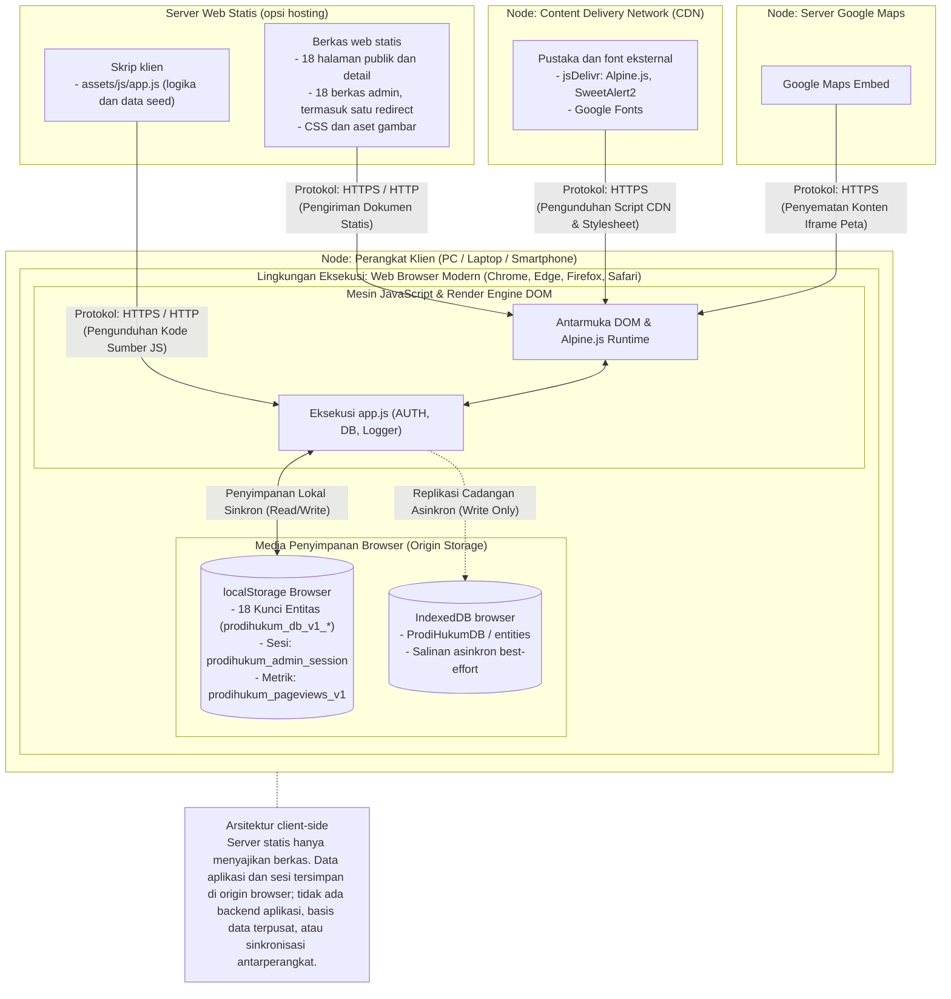
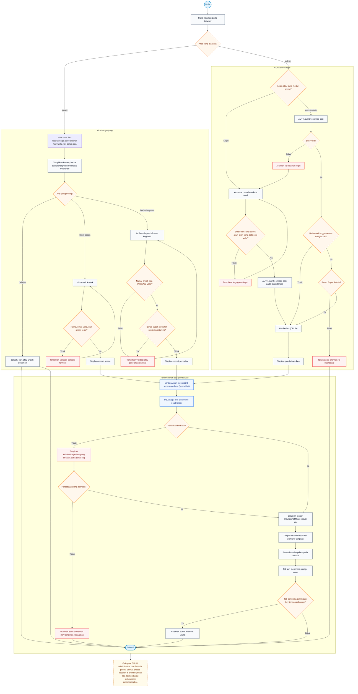

# 🏛️ ANALISA PERANCANGAN SISTEM & KUMPULAN DIAGRAM MERMAID (FINAL)

## Website Profil & Panel Admin Program Studi Hukum — Universitas Muhammadiyah Papua (UMP)

> Dokumen ini adalah **kumpulan lengkap diagram rekayasa perangkat lunak dalam format Mermaid** dan analisis perancangan sistem untuk Website Profil dan Panel Administrasi Program Studi Hukum Universitas Muhammadiyah Papua. Seluruh kode Mermaid di bawah ini diverifikasi konsisten dan akurat terhadap basis kode frontend (`assets/js/app.js`, `assets/css/style.css`, 36 berkas HTML) berdasarkan audit Oktober 2026.

---

## 📑 DAFTAR ISI DIAGRAM

1. [1. Data Flow Diagram (DFD) Level 0 — Diagram Konteks](#1-data-flow-diagram-dfd-level-0--diagram-konteks)
2. [2. Data Flow Diagram (DFD) Level 1 — Dekomposisi Proses Utama](#2-data-flow-diagram-dfd-level-1--dekomposisi-proses-utama)
3. [3. Flowchart Sistem — Logika Navigasi Publik & Panel Admin](#3-flowchart-sistem--logika-navigasi-publik--panel-admin)
4. [4. Entity Relationship Diagram (ERD) — 18 Entitas Data](#4-entity-relationship-diagram-erd--18-entitas-data)
5. [5. Component Diagram — Arsitektur 4-Layer Client-Side](#5-component-diagram--arsitektur-4-layer-client-side)
6. [6. Sequence Diagram — 4 Skenario Krusial Transaksi Data](#6-sequence-diagram--4-skenario-krusial-transaksi-data)
7. [7. Use Case Diagram — Aktor & Use Cases](#7-use-case-diagram--aktor--use-cases)
8. [8. Deployment Diagram — Topologi Fisik & Runtime CDN](#8-deployment-diagram--topologi-fisik--runtime-cdn)
9. [9. Activity Diagram — Interaksi Publik, Admin, dan Persistensi](#9-activity-diagram--interaksi-publik-admin-dan-persistensi)
10. [10. Panduan Penggunaan Berkas Draw.io XML](#10-panduan-penggunaan-berkas-drawio-xml)

---

## Catatan Audit (Oktober 2026)

| Aspek | Nilai Terverifikasi |
|-------|-------------------|
| Total SEED entities | **18** (SEED_AKTIVITAS, SEED_ALUMNI, SEED_ARTIKEL, SEED_BERITA, SEED_DOKUMEN, SEED_DOSEN, SEED_GALERI, SEED_KEGIATAN, SEED_KURIKULUM, SEED_NOTIFIKASI, SEED_PENDAFTAR, SEED_PENGATURAN, SEED_PENGGUNA, SEED_PENGUMUMAN, SEED_PESAN, SEED_PRESTASI, SEED_PROFIL, SEED_STRUKTUR) |
| Total MK Kurikulum | **57 MK** dari workbook MK Baru |
| Total SKS | **154 SKS** |
| Distribusi semester | S1=9, S2=8, S3=10, S4=10, S5=8, S6=9, S7=2, S8=1 MK |
| MK tanpa dosen pengampu | **10 MK** (dikosongkan by design) |
| Total Dosen | **11 dosen** (10 berkode HKM001–HKM010, 1 tanpa kode) |
| Alpine.js functions | **28 functions** |
| Total halaman HTML | **36 files** (13 publik + 5 detail + 18 admin) |
| DOSEN fields aktual | `id, nama, kode, jabatan, pendidikan, spesialisasi, foto, email, telepon` |
| KURIKULUM fields aktual | `id, kode, nama, sks, semester, kategori, deskripsi, pengampu, kodeDosen` |
| PENGATURAN social media | `facebook, instagram, youtube, linkedin, tiktok` |
| Bad chars di app.js | 0 |
| DB.save/DB.load parity | ✅ Semua 18 key konsisten |

---

## 1. Data Flow Diagram (DFD) Level 0 — Diagram Konteks

### 1.1 Deskripsi & Batasan Sistem

DFD Level 0 menggambarkan batas terluar sistem — seluruh entitas eksternal (Pengunjung Publik, Administrator) dan pertukaran aliran data global dengan sistem utama. Sistem berjalan **murni di sisi browser** tanpa API server atau backend.

### 1.2 Kode Mermaid (DFD Level 0)

---

## 2. Data Flow Diagram (DFD) Level 1 — Dekomposisi Proses Utama

### 2.1 Deskripsi Proses & Media Penyimpanan

DFD Level 1 membedah proses utama menjadi **10 Sub-Proses Fungsional** dan menghubungkannya dengan **18 Data Store** berbasis `localStorage` dengan namespace `prodihukum_db_v1_<entity>` serta cadangan asinkron IndexedDB.

### 2.2 Kode Mermaid (DFD Level 1)

---

## 3. Flowchart Sistem — Logika Navigasi Publik & Panel Admin

### 3.1 Deskripsi Alur Logika

Flowchart Sistem membagi alur logika menjadi dua modul terpisah:

1. **Alur Pengunjung Publik**: Buka halaman, navigasi konten, pencarian instan, registrasi kegiatan (validasi email unik per kegiatanId), pengiriman pesan kontak (ditulis ke `pesan` store), unduh dokumen, dan pergantian tema.
2. **Alur Panel Administrasi**: Pengecekan sesi, validasi autentikasi, otorisasi RBAC guard (Super Admin untuk pengguna/pengaturan), CRUD, pencatatan `logActivity`, auto-pruning bila kuota penuh, dan logout.

### 3.2 Kode Mermaid (Flowchart Sistem)

---

## 4. Entity Relationship Diagram (ERD) — 18 Entitas Data

### 4.1 Deskripsi Struktur Skema & Relasi

ERD mendefinisikan **18 entitas data** (16 array record + 2 objek tunggal) yang disimpan di localStorage dengan namespace `prodihukum_db_v1_<key>`:

- **Relasi Lookup 1**: `KEGIATAN.id ← PENDAFTAR.kegiatanId` — pendaftar menyimpan snapshot `kegiatanNama` sebagai teks.
- **Relasi Lookup 2**: `DOSEN.id ← STRUKTUR.dosenId` — opsional; baris STRUKTUR boleh tanpa dosenId.
- **Relasi Lookup 3**: `DOSEN.nama ↔ KURIKULUM.pengampu` — pencocokan nama ternormalisasi; `kodeDosen` hanya teks informatif, bukan FK.
- **PESAN**: ditulis oleh `contactForm()`, tidak memiliki relasi FK ke entitas lain.
- **PROFIL & PENGATURAN**: objek tunggal (bukan array); PENGATURAN menyimpan identitas situs, SEO, dan **5 akun sosial media**.

### 4.2 Field Aktual per Entitas (Terverifikasi dari SEED_*)

| Entitas | Fields Kunci |
|---------|-------------|
| DOSEN | `id, nama, kode, jabatan, pendidikan, spesialisasi, foto, email, telepon` |
| KURIKULUM | `id, kode, nama, sks, semester, kategori, deskripsi, pengampu, kodeDosen` |
| PENGATURAN | `namaWebsite, deskripsi, logo, favicon, theme, primaryColor, darkMode, metaTitle, metaDesc, keywords, facebook, instagram, youtube, linkedin, tiktok, email, telepon, alamat, mapEmbed, mapLink, koordinat, mahasiswaAktif` |
| STRUKTUR | `id, dosenId (opsional), nama, jabatan, foto` |

### 4.3 Kode Mermaid (ERD — 18 Entitas)

```mermaid
erDiagram
    %% Asosiasi berikut adalah lookup aplikasi; tidak ada foreign-key enforcement.
    KEGIATAN o|--o{ PENDAFTAR : "lookup opsional melalui kegiatanId"
    DOSEN o|--o{ STRUKTUR : "lookup opsional melalui dosenId"
    DOSEN o|--o{ KURIKULUM : "pencocokan nama pengampu"

    %% ==========================================
    %% DOMAIN 1: AKADEMIK & STRUKTUR ORGANISASI
    %% ==========================================
    DOSEN {
        number id PK "ID unik dosen"
        string nama "Nama lengkap beserta gelar"
        string kode "Kode dosen (contoh: HKM001; dapat kosong)"
        string jabatan "Jabatan akademik"
        string pendidikan "Riwayat pendidikan terakhir"
        string spesialisasi "Bidang keahlian hukum"
        string foto "Path file foto dosen"
        string email "Email resmi dosen"
        string telepon "Nomor kontak telepon"
    }

    STRUKTUR {
        number id PK "ID posisi struktur"
        number dosenId "Lookup opsional ke DOSEN.id"
        string nama "Nama pejabat struktural"
        string jabatan "Nama jabatan struktural"
        string foto "Path file foto pejabat"
    }

    KURIKULUM {
        number id PK "ID mata kuliah"
        string kode "Kode mata kuliah"
        string nama "Nama mata kuliah"
        number sks "Bobot SKS (1-6)"
        number semester "Semester sajian (1-8)"
        string kategori "Wajib / Pilihan / MBKM"
        string deskripsi "Deskripsi singkat capaian MK"
        string pengampu "Nama pengampu; dicocokkan setelah normalisasi"
        string kodeDosen "Kode dosen opsional; teks biasa, bukan relasi"
    }

    ALUMNI {
        number id PK "ID data alumni"
        string nama "Nama alumni"
        string angkatan "Tahun angkatan masuk"
        string pekerjaan "Pekerjaan/profesi saat ini"
        string instansi "Nama tempat bekerja/kantor"
        string kategori "Kategori karir alumni"
        string email "Email kontak alumni"
        string linkedin "Tautan profil LinkedIn"
        string status "Status verifikasi (Aktif/Pending)"
        string foto "Path file foto alumni"
    }

    PROFIL {
        string nama "Nama Program Studi [SINGLETON]"
        string kode "Kode Prodi Dikti"
        string fakultas "Nama Fakultas"
        string universitas "Nama Universitas"
        string akreditasi "Peringkat Akreditasi BAN-PT"
        string deskripsi "Deskripsi profil program studi"
        string sejarah "Sejarah pendirian prodi"
        string visi "Pernyataan visi keilmuan"
        string misi "Pernyataan butir-butir misi"
        string tujuan "Tujuan pendidikan prodi"
        string lulusan "Profil lulusan sarjana"
    }

    %% ==========================================
    %% DOMAIN 2: INFORMASI & PUBLIKASI
    %% ==========================================
    BERITA {
        number id PK "ID unik berita"
        string slug "Slug URL ramah SEO"
        string judul "Judul berita"
        string kategori "Kategori berita"
        string tanggal "Tanggal publikasi (DD MMMM YYYY)"
        string penulis "Nama penulis berita"
        string excerpt "Ringkasan pembuka"
        string konten "Isi lengkap berita (HTML)"
        string status "Status publikasi, misalnya Published atau Draft"
        boolean featured "Status sorotan di beranda"
        string gambar "Path atau URL file gambar"
    }

    ARTIKEL {
        number id PK "ID artikel ilmiah/populer"
        string judul "Judul artikel"
        string penulis "Nama penulis artikel"
        string kategori "Kategori hukum"
        string tanggal "Tanggal terbit"
        string isi "Konten artikel lengkap"
        string referensi "Daftar rujukan pustaka"
        string tags "Daftar tag pemisah koma"
        string status "Published / Draft"
        string thumbnail "Path gambar miniatur"
    }

    PENGUMUMAN {
        number id PK "ID pengumuman"
        string judul "Judul pengumuman akademik"
        string status "Penting / Info / Urgent"
        string badge "Teks label badge visual"
        string tanggal "Tanggal rilis"
        string isi "Informasi detail pengumuman"
        string lampiran "Nama atau tautan file lampiran"
    }

    KEGIATAN {
        number id PK "ID kegiatan/event"
        string nama "Nama kegiatan atau seminar"
        string tanggal "Tanggal kegiatan"
        string hari "Nama hari pelaksanaan"
        string bulan "Bulan pelaksanaan"
        string waktu "Waktu pelaksanaan (WIB/WIT)"
        string lokasi "Tempat atau media online"
        string penyelenggara "Panitia pelaksana"
        string deskripsi "Deskripsi lengkap acara"
        string gambar "Poster atau banner acara"
    }

    GALERI {
        number id PK "ID foto galeri"
        string judul "Judul foto kegiatan"
        string album "Nama album kegiatan"
        string src "Path gambar atau URL data"
    }

    PRESTASI {
        number id PK "ID prestasi mahasiswa/prodi"
        string nama "Nama prestasi atau kejuaraan"
        string kategori "Akademik / Non-Akademik"
        string tingkat "Lokal / Regional / Nasional / Internasional"
        string tahun "Tahun perolehan prestasi"
        string foto "Dokumentasi foto sertifikat/trofi"
    }

    DOKUMEN {
        number id PK "ID dokumen unduhan"
        string nama "Nama resmi dokumen"
        string kategori "Panduan / Formulir / SK / Kurikulum"
        string format "Format ekstensi file (PDF/DOCX)"
        string ukuran "Ukuran file (contoh: 2.4 MB)"
        string fileName "Nama berkas fisik"
        string fileData "Base64 data URI atau path file"
    }

    %% ==========================================
    %% DOMAIN 3: INTERAKSI PUBLIK
    %% ==========================================
    PENDAFTAR {
        number id PK "ID pendaftaran"
        number kegiatanId "Lookup aplikasi ke KEGIATAN.id"
        string kegiatanNama "Snapshot teks nama kegiatan saat mendaftar"
        string nama "Nama lengkap pendaftar"
        string email "Email; duplikasi dicek per kegiatan oleh aplikasi"
        string whatsapp "Nomor WhatsApp aktif"
        string instansi "Asal kampus/sekolah/instansi"
        string waktuDaftar "Timestamp ISO pendaftaran"
    }

    PESAN {
        number id PK "ID pesan masuk"
        string nama "Nama pengirim pesan"
        string email "Email pengirim"
        string subjek "Topik atau perihal pesan"
        string pesan "Isi pesan kontak"
        string waktu "Timestamp waktu kirim pesan"
        boolean read "Status sudah dibaca oleh admin"
    }

    %% ==========================================
    %% DOMAIN 4: SISTEM & ADMINISTRASI
    %% ==========================================
    PENGGUNA {
        number id PK "ID pengguna sistem"
        string nama "Nama staf / administrator"
        string email "Email login"
        string password "Kata sandi yang dicocokkan di sisi klien"
        string role "Super Admin / Editor / Operator"
        string status "Aktif / Nonaktif"
    }

    AKTIVITAS {
        number id PK "ID log aktivitas"
        string user "Nama pelaku aksi / sistem"
        string aksi "Deskripsi tindakan yang dilakukan"
        string waktu "Waktu relatif (contoh: 5 menit lalu)"
        string tanggalIso "Waktu absolut ISO 8601"
        string icon "Nama ikon representasi visual"
    }

    NOTIFIKASI {
        number id PK "ID notifikasi sistem"
        string judul "Judul pemberitahuan"
        string pesan "Rincian pesan notifikasi"
        string waktu "Waktu pemberitahuan"
        boolean read "Status dibaca (true/false)"
        string icon "Ikon kategori notifikasi"
    }

    PENGATURAN {
        string namaWebsite "Judul situs web [SINGLETON]"
        string deskripsi "Deskripsi meta website"
        string logo "Path gambar logo instansi"
        string favicon "Path icon favicon browser"
        string theme "Tema warna aktif"
        string primaryColor "Kode warna hex primer"
        boolean darkMode "Status mode gelap"
        string metaTitle "SEO meta title"
        string metaDesc "SEO meta description"
        string keywords "SEO kata kunci"
        string facebook "URL profil Facebook"
        string instagram "URL profil Instagram"
        string youtube "URL kanal YouTube"
        string linkedin "URL profil LinkedIn"
        string tiktok "URL profil TikTok"
        string email "Email resmi prodi"
        string telepon "Nomor telepon prodi"
        string alamat "Alamat fisik kampus"
        string mapEmbed "HTML iframe embed peta Google"
        string mapLink "Tautan langsung Google Maps"
        string koordinat "Koordinat lintang/bujur"
        number mahasiswaAktif "Jumlah mahasiswa aktif terkini"
    }

    %% =========================================================================
    %% Model mencakup 18 key data aplikasi: 16 daftar dan dua objek tunggal
    %% (PROFIL, PENGATURAN). Key sesi admin dan statistik pageview disimpan
    %% terpisah. ID dan tiga asosiasi di atas dikelola aplikasi; tidak ada
    %% constraint, cascade delete, atau transaksi basis data relasional.
    %% =========================================================================
```

---

## 5. Component Diagram — Arsitektur 4-Layer Client-Side

### 5.1 Deskripsi Lapisan Perangkat Lunak

Sistem dirancang dengan arsitektur **4-Layer murni di sisi peramban**:

1. **Presentation & Styling Layer**: 36 berkas HTML (13 publik + 5 detail + 18 admin), Neumorphism Design System (`style.css`), Tailwind CSS pre-built.
2. **Reactive Controller Layer**: Alpine.js 3.14.8 — **28 functions** (`siteHeader`, `homeStats`, `kurikulumPage`, `dosenPage`, `contactForm`, `adminShell`, `adminDosenPage`, `adminCrudTable`, `adminGaleriPage`, `adminPenggunaTable`, `adminDokumenTable`, `kegiatanAdminPage`, `adminAktivitasPage`, dll.)
3. **Core Engine & Business Logic Layer**: `AUTH` module, `DB` engine, `IDB` module, `SEED_*` 18 fixtures, pruning manager, activity logger.
4. **Storage & External Services Layer**: `localStorage` (~5 MB quota), IndexedDB (write-through only), Google Maps Embed, Google Fonts, CDN providers.

### 5.2 Kode Mermaid (Component Diagram)

---

## 6. Sequence Diagram — 4 Skenario Krusial Transaksi Data

### 6.1 Deskripsi Skenario

1. **Skenario 1**: Registrasi Kegiatan oleh Pengunjung Publik (validasi email unik per kegiatanId + logPublicEvent).
2. **Skenario 2**: Autentikasi Login Admin & RBAC Guard.
3. **Skenario 3**: CRUD dengan Auto-Pruning Storage (QuotaExceededError handler).
4. **Skenario 4**: Pengiriman Pesan Kontak ke pesan store.

### 6.2 Kode Mermaid (Sequence Diagram)

---

## 7. Use Case Diagram — Aktor & Use Cases

### 7.1 Pemetaan Aktor & Hak Akses

- **Pengunjung Publik**: Eksplorasi konten, pencarian global, pendaftaran kegiatan, kirim pesan kontak, ganti tema, unduh dokumen.
- **Admin (Editor / Operator)**: Login, dashboard, kelola modul konten umum (berita, artikel, kegiatan, pengumuman, alumni, prestasi, galeri, dokumen, dosen, kurikulum, profil).
- **Super Admin**: Semua hak admin + manajemen pengguna (RBAC) + konfigurasi pengaturan situs (identitas, SEO, sosmed, kontak, peta).

### 7.2 Kode Mermaid (Use Case Diagram)

---

## 8. Deployment Diagram — Topologi Fisik & Runtime CDN

### 8.1 Arsitektur Komputasi & Jaringan

Sistem beroperasi di bawah model **Static Hosting / Jamstack**:

1. **Static Web Server**: Menyajikan 36 berkas HTML dan folder aset statis (`assets/`).
2. **Client Node**: Browser modern menjalankan Alpine.js 3.14.8, `app.js` (core engine), dan menyimpan data di localStorage.
3. **Cloud CDN**: Alpine.js 3.14.8, SweetAlert2 v11, Google Fonts (Inter + Poppins), Tailwind CSS.

### 8.2 Kode Mermaid (Deployment Diagram)

---

## 9. Activity Diagram — Interaksi Publik, Admin, dan Persistensi

Activity diagram merangkum validasi formulir publik, pemeriksaan login dan guard admin, operasi CRUD, serta perilaku `DB.save()` saat penulisan lokal berhasil atau gagal. Salinan IndexedDB hanya best-effort. Tab lain menerima `storage` event, tetapi halaman publik hanya memuat ulang untuk perubahan data konten yang relevan.

Sumber Mermaid: [`activity-diagram.mmd`](docs/diagrams/activity-diagram.mmd). Draw.io: [`activity-diagram.drawio.xml`](docs/diagrams/drawio/activity-diagram.drawio.xml).

### 9.1 Kode Mermaid (Activity Diagram)

## 10. Panduan Penggunaan Berkas Draw.io XML

Untuk mengedit atau membuka diagram di aplikasi **[draw.io (diagrams.net)](https://app.diagrams.net)**, gunakan berkas XML yang tersedia di folder [`docs/diagrams/drawio/`](docs/diagrams/drawio/):

| Nama Diagram | Berkas XML Draw.io | Tipe |
| --- | --- | --- |
| **DFD Level 0** | [`dfd-level-0.drawio.xml`](docs/diagrams/drawio/dfd-level-0.drawio.xml) | `.drawio.xml` |
| **DFD Level 1** | [`dfd-level-1.drawio.xml`](docs/diagrams/drawio/dfd-level-1.drawio.xml) | `.drawio.xml` |
| **Flowchart Sistem** | [`flowchart-sistem.drawio.xml`](docs/diagrams/drawio/flowchart-sistem.drawio.xml) | `.drawio.xml` |
| **ER Diagram (18 Entitas)** | [`er-diagram.drawio.xml`](docs/diagrams/drawio/er-diagram.drawio.xml) | `.drawio.xml` |
| **Component Diagram** | [`component-diagram.drawio.xml`](docs/diagrams/drawio/component-diagram.drawio.xml) | `.drawio.xml` |
| **Sequence Diagram** | [`sequence-diagram.drawio.xml`](docs/diagrams/drawio/sequence-diagram.drawio.xml) | `.drawio.xml` |
| **Use Case Diagram** | [`usecase-diagram.drawio.xml`](docs/diagrams/drawio/usecase-diagram.drawio.xml) | `.drawio.xml` |
| **Deployment Diagram** | [`deployment-diagram.drawio.xml`](docs/diagrams/drawio/deployment-diagram.drawio.xml) | `.drawio.xml` |
| **Activity Diagram** | [`activity-diagram.drawio.xml`](docs/diagrams/drawio/activity-diagram.drawio.xml) | `.drawio.xml` |
| **Master Semua Diagram (9 Tab)** | [`all-diagrams.drawio.xml`](docs/diagrams/drawio/all-diagrams.drawio.xml) | `.drawio.xml` |

### Cara Buka di Draw.io

1. **Via File**: Buka [app.diagrams.net](https://app.diagrams.net) → **Open Existing Diagram** → pilih file `.drawio.xml`.
2. **Via Copy-Paste**: Buka file `.drawio.xml` di VS Code → Ctrl+A, Ctrl+C → di draw.io klik **Extras** → **Edit Diagram...** → Ctrl+V → **Apply**.

> **Catatan:** Berkas Draw.io XML (`.drawio.xml`) adalah representasi visual dari diagram yang sama dengan file `.mmd` di `docs/diagrams/`. Sumber kebenaran terbaru adalah file `.mmd` — update draw.io XML setelah perubahan signifikan pada data.
